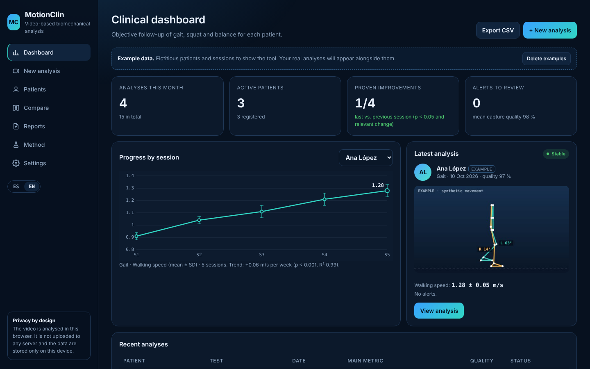
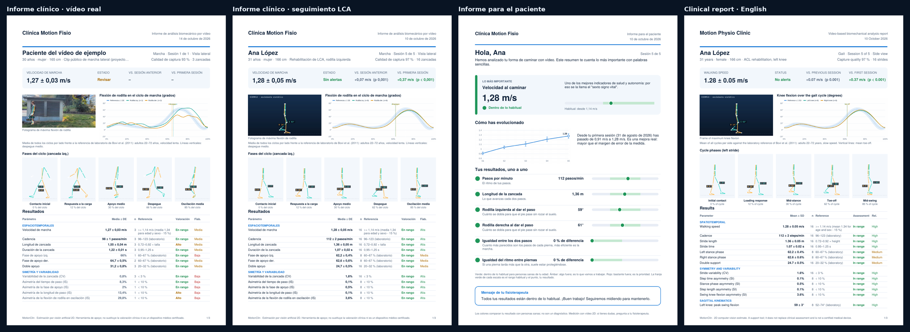
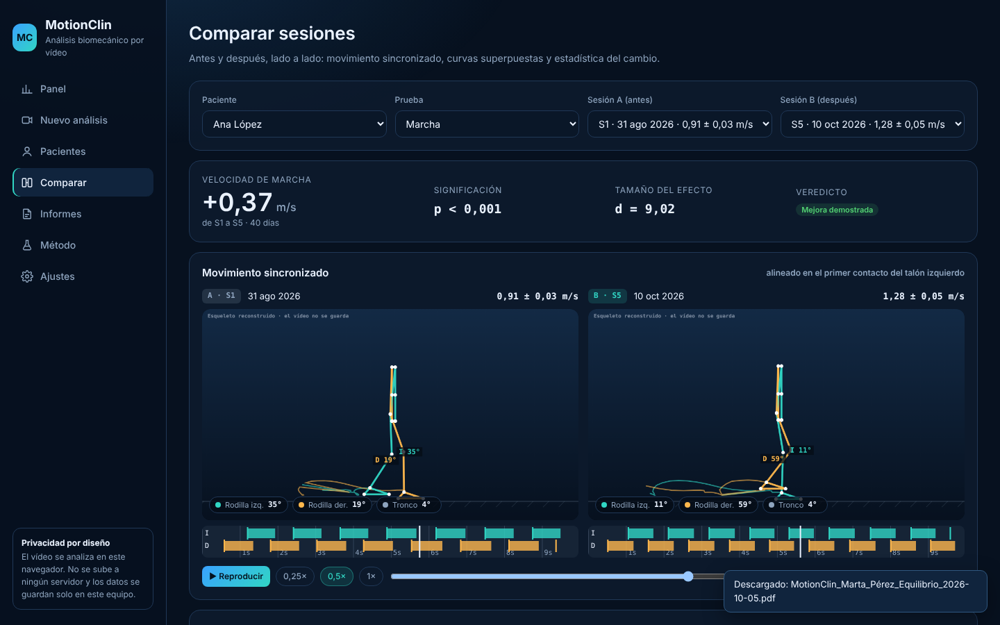

<div align="center">

# MotionClin

**Video-based biomechanics for physiotherapy, running entirely in the browser**

From a phone video to a clinical report: 33 body landmarks tracked with AI, metrics with their uncertainty, published reference values and statistics across sessions. The video never leaves the device.

[](https://diegotraski.github.io/motionclin/?lang=en)

[](https://github.com/diegotraski/motionclin/actions/workflows/tests.yml)


[Versión en español](README.md)

</div>

> The app is fully bilingual (ES/EN toggle in the sidebar; it opens in English when your browser is not in Spanish). The detailed technical documentation is in Spanish; this page summarises the project for English-speaking readers.

## In 30 seconds

A physiotherapist films a patient walking, squatting, rising from a chair or standing still. MotionClin tracks the body in every frame, computes the clinical variables of that test and compares them with the literature and with the patient's previous sessions.

What makes it more than a pose-detection demo:

- **Published methods**, not loose angles: Zeni gait events, Gait Variable Score, Robinson symmetry index, frontal-plane projection angle (dynamic knee valgus), inverted-pendulum sway.
- **Every number with its uncertainty**: mean ± SD across cycles, n, and a reliability level that depends on camera view and landmark visibility. Low-reliability values never raise alerts.
- **"Improvement" only when it is one**: Welch's t-test plus each variable's minimal clinically important difference.
- **Verified**: 30 simulated subjects per test with known ground truth. This verification exposed two engine bugs, which are documented and fixed.

**Try it:** open the [demo in English](https://diegotraski.github.io/motionclin/?lang=en) and click *Analyse a real example video*.

<div align="center"></div>

## For reviewers

**A 5-minute tour:**

1. **[Open the demo in English](https://diegotraski.github.io/motionclin/?lang=en)** and click *Analyse a real example video*: the skeleton, angles and metrics are computed live in the browser (1–2 minutes).
2. **[Ana's comparator](https://diegotraski.github.io/motionclin/?lang=en#comparar-demo-a0~demo-a4)**: first and fifth sessions synchronised, with the statistical verdict.
3. **PDF reports** made by the app: [clinical](examples/informes/en/gait-ACL-follow-up.pdf) and [patient](examples/informes/en/patient-gait-fifth-session.pdf).
4. **[docs/METODO.md](docs/METODO.md)** (Spanish): every number with its formula and reference.
5. **[validacion/](validacion/README.md)** (Spanish): how it would be compared against a gait lab, with an example report.

**What it demonstrates:**

| Area | Evidence |
|---|---|
| Data analysis and statistics | Mean ± SD with n per variable, Welch's t-test, Cohen's d, minimal clinically important change, trend regression, Bland–Altman, bootstrap ICC, SEM and MDC95 ([`js/metrics.js`](js/metrics.js), [`js/agreement.js`](js/agreement.js)) |
| Signal processing | Resampling, left/right swap correction, segment-length cleaning, zero-phase Butterworth filtering, event detection and cycle normalisation |
| Rigour and verification | Motion simulator with known ground truth, 30 subjects per test ([VALIDACION.md](VALIDACION.md)); published laboratory reference data (Bovi et al., 2011) |
| Software quality | 25 tests, 98.7 % engine coverage, ESLint and CI that analyses a real video in Chromium on every push ([GitHub Actions](https://github.com/diegotraski/motionclin/actions)) |
| Healthcare domain | Real clinical tests, age norms, privacy by design (GDPR) and a clinical validation protocol |
| Product | Installable offline app, synchronised review player, before/after comparator, clinician and patient PDFs, Spanish and English |

No frameworks and no server: apart from MediaPipe (body landmark detection) and jsPDF (PDF drawing), all the code is in this repository and reads exactly as it runs.

<div align="center"></div>

## Example clinical cases

The three demo patients are fictitious: their movement is generated by a simulator with known parameters and analysed by the same engine as real video.

| Case | What it shows | View |
|---|---|---|
| **Ana, 31 · ACL rehabilitation.** Reduced left-knee flexion while walking. | Over 5 sessions, swing knee flexion rises from 38° to 59°, gait speed from 0.91 to 1.28 m/s (p < 0.001, demonstrated improvement) and knee asymmetry falls from 46 % to 4 %. | [Comparator](https://diegotraski.github.io/motionclin/#comparar-demo-a0~demo-a4) · [Report](examples/informes/marcha-seguimiento-LCA.pdf) |
| **Carlos, 38 · patellofemoral pain.** Knees collapse inwards during squats. | Dynamic valgus (FPPA) drops from 19° to 7° and squat depth increases from 84° to 98°. | [Session](https://diegotraski.github.io/motionclin/#sesion-demo-a7) · [Report](examples/informes/sentadilla-valgo-dinamico.pdf) |
| **Marta, 76 · fall prevention.** Two falls in the last year. | Five-times sit-to-stand improves from 14.2 s (above the age norm of 12.6 s) to 11.4 s; postural sway decreases significantly. | [Comparator](https://diegotraski.github.io/motionclin/#comparar-demo-a12~demo-a14) · [Report](examples/informes/levantarse-silla-x5.pdf) |

<div align="center">

</div>

## Features

- **Analyse** a phone video or the live camera, with the skeleton drawn while it processes.
- **Review** with a synchronised player: slow motion, frame stepping, live angles and a gait-phase timeline. Clicking a chart jumps the video to that instant.
- **Compare** two sessions side by side: synchronised movement (aligned on heel strike), overlaid curves over the normative band and change statistics.
- **Track** progress with error bars and a weekly linear trend with its p-value.
- **Report** as a PDF with reference values, reliability, charts, method and bibliography ([example in English](examples/informes/en/gait-ACL-follow-up.pdf)).
- **Explain it to the patient** with a one-page plain-language report: green/amber/red against healthy people of their age, a visual scale for each result, progress since the first session and a note from the physiotherapist ([example](examples/informes/en/patient-gait-fifth-session.pdf)).
- **Spanish and English**: interface, stored analyses, charts and PDFs switch language in one click.
- **Export** filtered time series, events and cycle averages as CSV.
- **Work offline** as an installable PWA; the vision model is cached on the device.

Clinical tests: **gait** (lateral view), **squat** (lateral or frontal), **five-times sit-to-stand** (lateral) and **standing balance** (frontal).

## Scientific approach

The pipeline is: uniform resampling → left/right swap correction by temporal continuity → visibility and segment-length cleaning → zero-phase Butterworth low-pass filter with Winter's correction → events, cycles, spatial scaling from body height → per-cycle statistics. Every step, with formulas and 25 references, is in [docs/METODO.md](docs/METODO.md) (Spanish).

Verification on 30 simulated subjects per test ([full table](VALIDACION.md)):

| Variable | Mean absolute error | Max error |
|---|---|---|
| Gait · cadence | 0.24 steps/min | 0.46 steps/min |
| Gait · speed | 0.013 m/s | 0.049 m/s |
| Gait · peak knee flexion | 0.8–1.0° | 2.8° |
| Squat · depth | 0.23° | 0.51° |
| Sit-to-stand · time per repetition | 0.004 s | 0.009 s |

This verifies the processing when the pose is known. The pose model's own error against a 3D lab system is several degrees.

**Speed-matched laboratory references.** Knee curve, thigh band, cadence and stance phases are compared with the 3D motion-capture normative data of Bovi et al. (2011): 235 healthy people, split into young/adult and five walking speeds. MotionClin picks the patient's age group and speed class automatically, because 50° of knee flexion is normal when walking slowly but not when walking fast.

**Ready for a lab validation.** [`validacion/`](validacion/README.md) (Spanish) contains the agreement analysis (Bland–Altman, ICC with bootstrap CIs, curve RMSE and CMC, event timing error in ms, SEM and MDC95), the data format and a study protocol with sample size, setup, synchronisation and pre-specified acceptance criteria. Running it on lab data is one command: `npm run concordancia -- data.json`. See the [example report on simulated subjects](validacion/demo-informe.md).

## Engineering

- **No backend, no build step.** Plain HTML, CSS and JavaScript, deployed as-is on GitHub Pages. Patient video is processed on-device (privacy by design).
- **Pure analysis engine.** `js/metrics.js` has no DOM dependency: the same code runs in the browser, in the tests and [from Node scripts](examples/analizar-desde-node.js).
- **Pose sequence storage.** Each analysis stores the pose compressed to 16 bits (~70 kB per 10 s, < 0.1 px error), so old sessions can be replayed and compared without keeping the video.
- **Testing.** 25 unit tests with known values, a simulator-based verification suite, an end-to-end test in Chromium with real video, ESLint, and 98.7 % line coverage of the engine. GitHub Actions runs everything on every push.

Design decisions and rejected alternatives: [docs/ARQUITECTURA.md](docs/ARQUITECTURA.md) (Spanish).

## Run locally

```bash
git clone https://github.com/diegotraski/motionclin.git && cd motionclin
python3 -m http.server 8080        # open http://localhost:8080
npm install && npm test && npm run coverage && npm run validate   # Node 22+
npm run e2e                         # full app in Chromium on the real video
npm run concordancia -- data.json   # agreement analysis against lab data (validacion/)
```

## Limitations

2D measurement: out-of-plane angles are distorted, so each test requires a specific camera view. BlazePose landmarks are not anatomical markers. Reference values come from lab studies and are for context. **Not a certified medical device:** it supports, and does not replace, the physiotherapist's assessment.

---

<div align="center">
Built by <a href="https://github.com/diegotraski">Diego Trascasa García</a> · MIT License<br>
<sub>MediaPipe Pose (Apache 2.0) · jsPDF (MIT) · Sample video: <a href="https://github.com/davidpagnon/Sports2D">Sports2D</a> (BSD-3)</sub>
</div>
