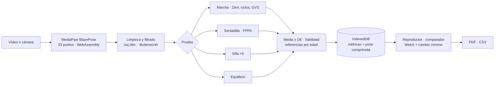

<div align="center">

# MotionClin

**Análisis biomecánico por vídeo para fisioterapia, en el navegador**

Del vídeo del móvil a un informe clínico: 33 puntos del cuerpo detectados con IA, métricas con su incertidumbre, valores de referencia publicados y estadística entre sesiones. El vídeo no sale del dispositivo.

[](https://diegotraski.github.io/motionclin/)

[](https://github.com/diegotraski/motionclin/actions/workflows/tests.yml)


<sub>Vídeo real procesado en el navegador: esqueleto, ángulos en directo, rastro de los tobillos y fases de apoyo de cada pierna (barras), detectadas con el método de Zeni.</sub>

[English version](README.en.md) · [Método](docs/METODO.md) · [Verificación](VALIDACION.md) · [Arquitectura](docs/ARQUITECTURA.md) · [Ejemplos](examples/)

</div>

---

## En 30 segundos

Un fisioterapeuta graba al paciente caminando, haciendo sentadillas, levantándose de una silla o en equilibrio. MotionClin localiza el cuerpo en cada fotograma, calcula las variables clínicas de esa prueba y las compara con la literatura y con las sesiones anteriores del paciente.

Lo que lo diferencia de una demo de detección de pose:

- **Métodos publicados**, no ángulos sueltos: eventos de la marcha de Zeni, Gait Variable Score, índice de simetría de Robinson, valgo dinámico FPPA, péndulo invertido.
- **Cada número con su incertidumbre**: media ± DE entre ciclos, n y un nivel de fiabilidad que depende de la vista y la visibilidad. Los valores poco fiables no generan alertas.
- **«Mejora» solo cuando lo es**: prueba t de Welch más el cambio mínimo clínicamente relevante de cada variable.
- **Verificado**: 30 sujetos simulados por prueba con valores conocidos. Esa verificación encontró dos errores del motor, que están documentados y corregidos.

**Pruébalo:** abre la [demo](https://diegotraski.github.io/motionclin/) y pulsa *Analizar un vídeo real de ejemplo*.

## Casos clínicos de ejemplo

Los tres pacientes de la demo son ficticios. Su movimiento lo genera un simulador con valores conocidos y lo analiza el mismo motor que un vídeo real.

| Caso | Qué muestra | Ver |
|---|---|---|
| **Ana, 31 años · rehabilitación de ligamento cruzado.** Déficit de flexión de la rodilla izquierda al caminar. | En 5 sesiones, la flexión en oscilación pasa de 38° a 59°, la velocidad de 0,91 a 1,28 m/s (p < 0,001, mejora demostrada) y la asimetría de la rodilla del 46 % al 4 %. | [Comparador](https://diegotraski.github.io/motionclin/#comparar-demo-a0~demo-a4) · [Informe](examples/informes/marcha-seguimiento-LCA.pdf) |
| **Carlos, 38 años · dolor patelofemoral.** Las rodillas se van hacia dentro en la sentadilla. | El valgo dinámico (FPPA) baja de 19° a 7° y la profundidad sube de 84° a 98°; la tabla por repetición muestra la consistencia. | [Sesión](https://diegotraski.github.io/motionclin/#sesion-demo-a7) · [Informe](examples/informes/sentadilla-valgo-dinamico.pdf) |
| **Marta, 76 años · prevención de caídas.** Dos caídas en el último año. | La prueba de la silla baja de 14,2 s (por encima de la media para su edad, 12,6 s) a 11,4 s, y la oscilación postural se reduce de forma significativa. | [Comparador](https://diegotraski.github.io/motionclin/#comparar-demo-a12~demo-a14) · [Informe](examples/informes/levantarse-silla-x5.pdf) |

<div align="center">

</div>

## Qué puede hacer

| | |
|---|---|
| **Analizar** | Vídeo del móvil o cámara en directo. El esqueleto y los ángulos se ven mientras se procesa. |
| **Revisar** | Reproductor sincronizado con cámara lenta, avance fotograma a fotograma, ángulos en vivo y línea de tiempo de las fases de la marcha. Al pulsar en la gráfica, el vídeo salta a ese instante. |
| **Comparar** | Dos sesiones lado a lado con el movimiento sincronizado, las curvas superpuestas sobre la banda normal y la estadística del cambio. |
| **Seguir** | Evolución con barras de error y tendencia semanal con su p. |
| **Informar** | PDF con tabla de referencias, fiabilidad, gráficas, comparación, método y bibliografía. |
| **Exportar** | CSV con series filtradas, eventos y ciclos para análisis propios; copia de seguridad en JSON. |
| **Trabajar sin conexión** | Se instala como app; el modelo de visión queda guardado en el dispositivo. |

### Pruebas clínicas

| Prueba | Vista | Variables principales |
|---|---|---|
| Marcha | lateral | Velocidad, cadencia, zancada, fases de apoyo, simetría, variabilidad, curvas de rodilla y cadera por ciclo, GVS |
| Sentadilla | lateral o frontal | Repeticiones, profundidad, cadera y tronco, valgo dinámico (FPPA), tiempos de bajada y subida |
| Levantarse de la silla ×5 | lateral | Tiempo con referencia por edad, regularidad, estrategia del tronco |
| Equilibrio | frontal | Velocidad y amplitud de la oscilación, apoyo monopodal con referencia por edad |

<div align="center">

<br><sub>Informes generados por la app. <a href="examples/informes/">Ver los cinco PDF</a>.</sub>
</div>

## Rigor científico

La cadena completa (remuestreo, corrección de intercambios izquierda/derecha, limpieza, filtro Butterworth de fase cero, eventos, ciclos, escala y estadística) está descrita con sus fórmulas en **[docs/METODO.md](docs/METODO.md)**, con 18 referencias.

**Verificación** con 30 sujetos simulados por prueba ([tabla completa](VALIDACION.md)):

| Variable | Error absoluto medio | Error máximo |
|---|---|---|
| Marcha · cadencia | 0,24 pasos/min | 0,46 pasos/min |
| Marcha · velocidad | 0,013 m/s | 0,049 m/s |
| Marcha · flexión máx. de rodilla | 0,8–1,0° | 2,8° |
| Sentadilla · profundidad | 0,23° | 0,51° |
| Silla ×5 · tiempo por repetición | 0,004 s | 0,009 s |

La verificación demuestra que el procesado recupera los valores verdaderos cuando la pose es conocida. El error propio del modelo de pose frente a un laboratorio 3D es de varios grados, y medirlo requeriría un estudio de validación clínica.

## Calidad del software

| | |
|---|---|
| Pruebas | 18 pruebas con valores conocidos (`npm test`), verificación con simulador (`npm run validate`) y prueba extremo a extremo en Chromium con un vídeo real |
| Cobertura | 98,6 % de las líneas del motor (`npm run coverage`) |
| Estilo | ESLint (`npm run lint`) |
| Integración continua | GitHub Actions en cada cambio: estilo, pruebas, cobertura, verificación y ejemplo de Node |
| Diseño | Motor de análisis puro, sin DOM: se usa igual en el navegador, en las pruebas y [desde scripts](examples/analizar-desde-node.js) |



Decisiones técnicas y alternativas descartadas en **[docs/ARQUITECTURA.md](docs/ARQUITECTURA.md)**.

## Ejecutarlo en local

Es una web estática, sin compilación:

```bash
git clone https://github.com/diegotraski/motionclin.git && cd motionclin
python3 -m http.server 8080        # o: npx serve .
```

Abre http://localhost:8080. Para las herramientas de desarrollo (Node 22 o superior):

```bash
npm install
npm test            # pruebas
npm run coverage    # cobertura del motor
npm run validate    # verificación con 30 sujetos simulados por prueba
npm run lint        # estilo
npm run example     # usar el motor desde Node con un vídeo real
```

## Cómo grabar

- **Marcha:** cámara lateral, fija y perpendicular al recorrido, a 3–5 m; caminar de lado a lado 10–20 s.
- **Sentadilla:** lateral para profundidad y tronco, frontal para valgo; 3–5 repeticiones.
- **Silla ×5:** silla sin reposabrazos contra la pared, cámara lateral; empezar a grabar con el paciente sentado.
- **Equilibrio:** frontal, fija, 20–30 s; la misma colocación de cámara en todas las sesiones.
- Cuerpo completo en el encuadre, buena luz y ropa ajustada. Rellena talla, año de nacimiento y sexo en la ficha.

## Estructura

```
index.html  ·  css/app.css  ·  sw.js  ·  manifest.webmanifest
js/
  metrics.js    motor: señal, eventos, métricas, referencias, estadística   (sin DOM)
  synth.js      simulador de movimiento con valores conocidos                (sin DOM)
  replay.js     secuencia de pose comprimida a 16 bits                       (sin DOM)
  pose.js       MediaPipe: vídeo fotograma a fotograma y cámara
  player.js     reproductor de revisión sincronizado
  charts.js     gráficas para pantalla y PDF
  report.js     informe PDF
  storage.js    IndexedDB
  demo.js       pacientes de ejemplo
  app.js        vistas y navegación
tests/          pruebas, verificación y prueba extremo a extremo
examples/       informes PDF, datos de un análisis real y uso del motor desde Node
docs/           método, arquitectura e imágenes
samples/        vídeo real de ejemplo (Sports2D, BSD-3)
vendor/         MediaPipe Pose 0.5 (Apache 2.0) y jsPDF 2.5 (MIT)
```

## Límites

Es una medida en 2D: los ángulos fuera del plano de la cámara se deforman, por eso cada prueba pide una vista concreta. Los puntos de BlazePose no son marcadores anatómicos. Las referencias proceden de estudios de laboratorio y sirven para contextualizar. **No es un dispositivo médico certificado:** apoya la valoración del fisioterapeuta, no la sustituye.

## Siguientes pasos

- Validación frente a un sistema de captura 3D o una plataforma de presiones para cuantificar el error del modelo de pose.
- Calibración con un objeto de tamaño conocido como alternativa a la talla.
- Sincronización opcional y cifrada entre dispositivos de la misma clínica.

Historial de versiones en [CHANGELOG.md](CHANGELOG.md).

---

<div align="center">
Hecho por <a href="https://github.com/diegotraski">Diego Trascasa García</a> · Licencia MIT<br>
<sub>MediaPipe Pose (Apache 2.0) · jsPDF (MIT) · Vídeo de ejemplo: <a href="https://github.com/davidpagnon/Sports2D">Sports2D</a> (BSD-3)</sub>
</div>
