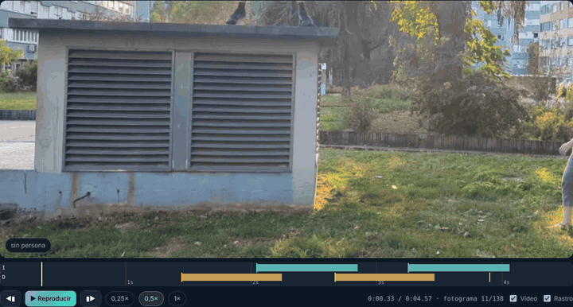
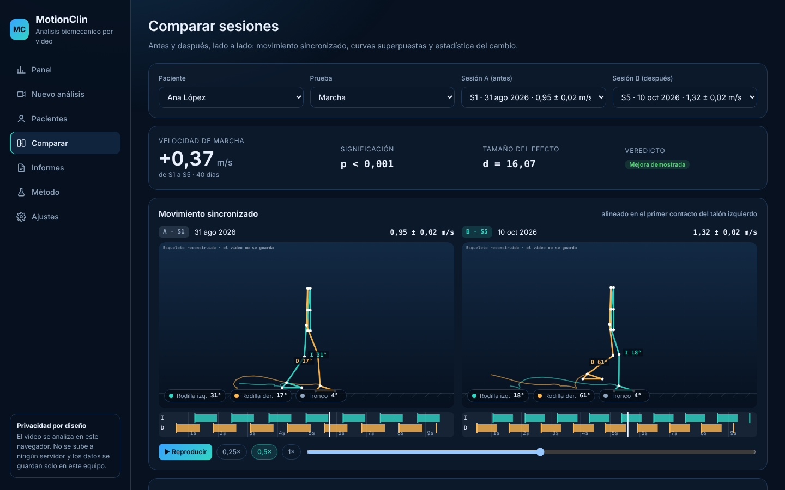
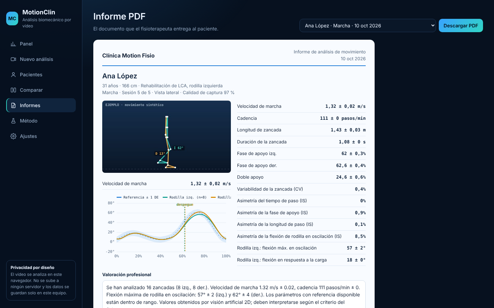
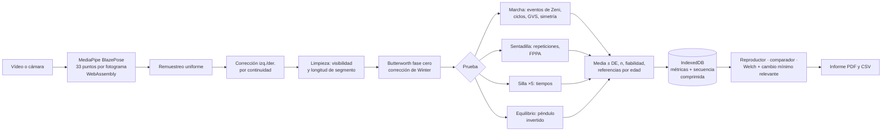

<div align="center">

# 🦵 MotionClin

**Análisis biomecánico por vídeo para clínicas de fisioterapia**

Se graba al paciente con el móvil o la webcam, la app localiza 33 puntos del cuerpo con IA y devuelve métricas clínicas con su incertidumbre, valores de referencia publicados, comparación estadística entre sesiones e informe PDF con método y bibliografía.

[](https://diegotraski.github.io/motionclin/)


[](https://github.com/diegotraski/motionclin/actions/workflows/tests.yml)




<sub>Vídeo real procesado en el navegador: esqueleto, ángulos en directo, rastro de los tobillos y fases de apoyo (barras) detectadas con el método de Zeni.</sub>

**▶︎ [Abre la demo](https://diegotraski.github.io/motionclin/) y pulsa «Analizar un vídeo real de ejemplo»: el análisis completo, sin grabar a nadie.**

</div>

<details>
<summary>🇬🇧 <b>English summary</b></summary>

<br>

**MotionClin** is a browser-based video biomechanics tool for physiotherapy clinics. The clinician records the patient with a phone or webcam; MediaPipe BlazePose tracks 33 body landmarks and a custom analysis engine (resampling, left/right swap correction, zero-phase Butterworth filtering) computes clinical metrics for gait, squat, 5× sit-to-stand and balance tests. Every metric is reported as mean ± SD with a reliability level and age/sex reference values from the literature; changes between sessions are tested with Welch's t-test, Cohen's d and minimal clinically important differences. A synchronized review player (slow motion, frame stepping, live angles, gait-phase timeline) and a side-by-side session comparator make changes visible, not just numeric. It generates a PDF report with method and references, exports raw data as CSV, and installs as an offline-capable PWA. Everything runs locally in the browser: video never leaves the device and data is stored in IndexedDB. The engine is verified against 30 simulated subjects per test.

</details>

---

## 🔒 Privacidad por diseño

Todo se ejecuta **en el navegador**: el vídeo no se sube a ningún servidor y los datos se guardan en el propio equipo (IndexedDB). La demo carga pacientes y sesiones **ficticios** generados con movimiento sintético.

## ✨ Qué puedes hacer

| | |
|---|---|
| **Analizar un vídeo** | Sube un vídeo del móvil o graba con la cámara. El esqueleto y los ángulos se ven en directo mientras se procesa. |
| **Revisar el movimiento** | Reproductor sincronizado con cámara lenta, avance fotograma a fotograma, ángulos en vivo y rastro de los tobillos. Al pulsar en la gráfica, el vídeo salta a ese instante. Las sesiones antiguas se reproducen como esqueleto, porque el vídeo nunca se guarda. |
| **Comparar antes y después** | Dos sesiones lado a lado con el movimiento sincronizado (alineado en el contacto del talón), curvas superpuestas sobre la banda normativa y la estadística del cambio. |
| **Seguir la evolución** | Evolución con barras de error, tendencia semanal con su p y cambios marcados solo cuando son significativos y clínicamente relevantes. |
| **Entregar un informe** | PDF con tabla de referencias, gráficas, comparación estadística, método y bibliografía. |
| **Exportar los datos** | CSV con las series filtradas, los eventos y los ciclos promedio de cada análisis, listo para un análisis estadístico propio. |
| **Usarla sin conexión** | Se instala como app en el móvil o el ordenador; el modelo de visión queda guardado y funciona sin internet. |

<div align="center">

</div>

## 🧪 Pruebas disponibles

| Prueba | Vista | Variables |
|---|---|---|
| **Marcha** | lateral | Velocidad, cadencia, longitud y duración de zancada, fase de apoyo, doble apoyo, variabilidad (CV), asimetría (índice de Robinson), curva de rodilla y cadera por ciclo, flexión en contacto inicial, respuesta a la carga y oscilación, desviación de la curva normal (GVS) |
| **Sentadilla** | lateral o frontal | Repeticiones, profundidad, consistencia, cadera y tronco (lateral), valgo dinámico FPPA (frontal), tiempos de bajada y subida, tabla por repetición |
| **Levantarse de la silla ×5** | lateral | Tiempo de la prueba con referencia por edad, tiempo y regularidad por repetición, estrategia del tronco |
| **Equilibrio** | frontal | Velocidad, RMS y rango de la oscilación angular (péndulo invertido), desplazamiento de la pelvis, detección de apoyo monopodal y tiempo hasta apoyar el pie con referencia por edad |

## 🔬 Qué lo hace científico

- **Cadena de procesado estándar en biomecánica**: remuestreo uniforme, corrección de intercambios izquierda/derecha, descarte por visibilidad y por longitud de segmento, interpolación de huecos cortos y filtro Butterworth de fase cero con la corrección de Winter.
- **Métodos publicados**: eventos de la marcha de Zeni et al. (2008), Gait Variable Score de Baker et al. (2009), índice de simetría de Robinson et al. (1987), FPPA de Munro et al. (2012), modelo de péndulo invertido de Winter (1995).
- **Incertidumbre explícita**: cada variable es media ± DE entre ciclos, repeticiones o ventanas, con su n y un nivel de fiabilidad (alta, media o baja) que depende de la vista, la visibilidad y el número de ciclos. Las variables de fiabilidad baja no generan alertas.
- **Referencias normativas** por edad y sexo cuando existen (velocidad: Bohannon 2011; silla: Bohannon 2006 y Buatois 2008; apoyo monopodal: Springer 2007; cinemática: Perry y Winter). Donde no hay normas validadas para el método (oscilación angular), se dice y la variable se usa solo para seguimiento.
- **Cambios entre sesiones con estadística**: prueba t de Welch entre los ciclos de dos sesiones, tamaño del efecto (d de Cohen) y cambio mínimo relevante (p. ej., 0,10 m/s en velocidad; Perera 2006). Solo se habla de «mejora» cuando el cambio es significativo y relevante. Con 3 o más sesiones, tendencia lineal por semana con su p.
- **Verificación reproducible**: `tests/validation.js` mide el error de cada variable en 30 sujetos simulados por prueba (ver [`VALIDACION.md`](VALIDACION.md)).

## 📄 Informes PDF

<div align="center">

</div>

Ejemplos de informes generados por la app:

- 📘 [Seguimiento de rehabilitación de LCA, 5 sesiones](docs/informe-ejemplo-seguimiento-LCA.pdf): paciente ficticio con movimiento sintético; incluye comparación estadística entre sesiones y tendencia.
- 📗 [Análisis de marcha con vídeo real](docs/informe-video-real-marcha.pdf): clip de demostración público del proyecto [Sports2D](https://github.com/davidpagnon/Sports2D), procesado de principio a fin.

## ✅ Verificación

| Variable | Error absoluto medio (30 sujetos simulados) |
|---|---|
| Marcha · velocidad | 0,012 m/s |
| Marcha · cadencia | 0,24 pasos/min |
| Marcha · flexión máx. de rodilla | 0,7–0,8° (máx. 2,4°) |
| Sentadilla · profundidad | 0,23° |
| Silla ×5 · tiempo por repetición | 0,004 s |

Tabla completa, prueba con vídeo real y los dos errores que esta verificación permitió encontrar y corregir en [`VALIDACION.md`](VALIDACION.md). Las pruebas se ejecutan en cada cambio con GitHub Actions.

```bash
node tests/metrics.test.js   # 18 pruebas con valores conocidos
node tests/validation.js     # verificación con 30 sujetos simulados por prueba
```

## 🚀 Ponerla en marcha

Es una web estática; necesita servirse por HTTP:

```bash
python3 -m http.server 8080      # o: npx serve .
```

Abre http://localhost:8080. Con https (como en la [demo](https://diegotraski.github.io/motionclin/)) funciona también la cámara en directo desde el móvil.

## 🎥 Cómo grabar

- **Marcha**: cámara lateral, fija y perpendicular al recorrido, a 3–5 m; caminar de lado a lado 10–20 s (ida y vuelta da más ciclos).
- **Sentadilla**: lateral para profundidad y tronco, frontal para valgo; 3–5 repeticiones.
- **Silla ×5**: silla sin reposabrazos contra la pared, cámara lateral; empezar a grabar con el paciente sentado.
- **Equilibrio**: frontal, fija, 20–30 s; misma colocación de cámara en todas las sesiones.
- Cuerpo completo en cuadro, buena luz, ropa ajustada. Rellena talla, año de nacimiento y sexo en la ficha.

## 🏗️ Arquitectura



- **Sin servidor.** Todo se ejecuta en el navegador; la app es estática y se publica en GitHub Pages.
- **Sin vídeo guardado.** De cada análisis se guardan las métricas y la secuencia de pose comprimida (33 puntos a 16 bits; ~70 kB por cada 10 s), suficiente para reproducir y comparar el movimiento.
- **Motor puro y probado.** `metrics.js` no depende del navegador: se prueba en Node con un simulador de movimiento (`synth.js`) que genera marcha, sentadillas, levantarse de la silla y equilibrio con valores conocidos.

## 📁 Estructura

```
index.html             interfaz
css/app.css            estilos
js/metrics.js          motor de análisis: señal, eventos, métricas, referencias, estadística
js/synth.js            simulador de movimiento con valores conocidos (pruebas y datos de ejemplo)
js/pose.js             MediaPipe: vídeo fotograma a fotograma, cámara en directo, dibujo del esqueleto
js/report.js           informe PDF
js/charts.js           gráficas (bandas normativas, barras de error)
js/player.js           reproductor de revisión sincronizado
js/replay.js           secuencia de pose comprimida (16 bits, base64)
js/storage.js          IndexedDB
js/demo.js             datos de ejemplo
js/app.js              interfaz
vendor/                MediaPipe Pose 0.5 y jsPDF 2.5
sw.js                  service worker: app instalable y sin conexión
samples/               vídeo real de ejemplo (Sports2D, BSD-3)
tests/metrics.test.js  18 pruebas con valores conocidos
tests/validation.js    verificación con 30 sujetos simulados por prueba
tests/e2e.js           prueba completa en Chromium con un vídeo real
tests/extract.js       extrae landmarks de un vídeo para analizarlos en Node
docs/                  capturas e informes de ejemplo
```

## ⚠️ Límites

Medida en 2D: los ángulos fuera del plano de la cámara se deforman, por eso cada prueba pide una vista. Los puntos de BlazePose no son marcadores anatómicos; frente a laboratorios 3D el error típico es de varios grados. **No es un dispositivo médico certificado**: apoya la valoración del fisioterapeuta.

## 🛣️ Siguientes pasos

- Validación clínica frente a un sistema optoelectrónico (Vicon, Qualisys) o plataforma de fuerzas para cuantificar el error del modelo de pose.
- Calibración con un objeto de tamaño conocido como alternativa a la talla.
- Cuentas y datos en la nube (Supabase) para usar la clínica desde varios equipos.

---

<div align="center">
Hecho por <a href="https://github.com/diegotraski">Diego Trascasa García</a> · Licencia MIT (las librerías de <code>vendor/</code> mantienen sus licencias: MediaPipe, Apache 2.0; jsPDF, MIT. Vídeo de ejemplo: <a href="https://github.com/davidpagnon/Sports2D">Sports2D</a>, BSD-3)
</div>
