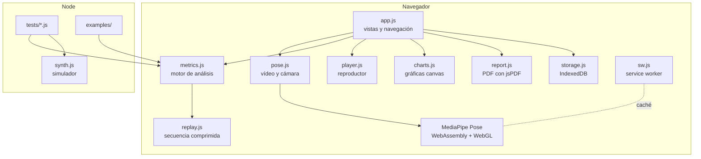
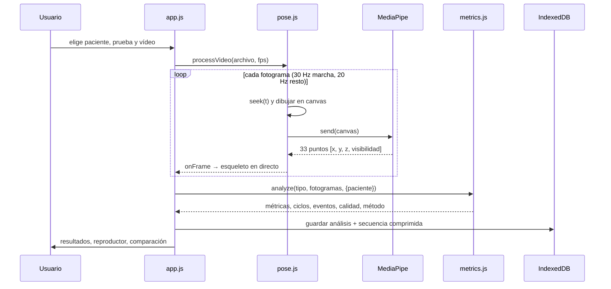

# Arquitectura

MotionClin es una aplicación web estática: HTML, CSS y JavaScript sin servidor, sin compilación y sin dependencias en tiempo de ejecución más allá de dos librerías incluidas en `vendor/`. Este documento explica cómo está organizada y por qué.

## Vista general



| Módulo | Responsabilidad | Depende del DOM |
|---|---|---|
| `js/metrics.js` | Procesado de señal, eventos, métricas, referencias normativas, estadística | No |
| `js/synth.js` | Simulador de movimiento con valores conocidos | No |
| `js/replay.js` | Compresión de la secuencia de pose (16 bits + base64) | No |
| `js/pose.js` | MediaPipe: vídeo fotograma a fotograma, cámara en directo, dibujo del esqueleto | Sí |
| `js/player.js` | Reproductor de revisión sincronizado | Sí |
| `js/charts.js` | Gráficas en canvas (bandas, barras de error, cursores) para pantalla y PDF | Sí |
| `js/report.js` | Informe PDF | Sí |
| `js/storage.js` | IndexedDB con alternativa en memoria | Sí |
| `js/demo.js` | Pacientes de ejemplo generados con el simulador y el motor | Sí |
| `js/app.js` | Vistas, navegación por hash, formularios | Sí |

La separación clave es que **el motor no sabe nada del navegador**. Recibe fotogramas `{ t, lm }` y devuelve un objeto de resultados. Gracias a eso se prueba en Node, se usa desde scripts (`examples/analizar-desde-node.js`) y se podría llevar a un servidor o a un worker sin tocarlo.

## Flujo de un análisis



El vídeo se recorre **buscando cada instante** (`video.currentTime = t`) en lugar de reproducirlo. Es más lento, pero es determinista: el mismo vídeo da siempre los mismos fotogramas, sin depender de la velocidad del ordenador.

## Modelo de datos

Dos almacenes en IndexedDB más uno de ajustes:

```js
// patients
{ id, name, birthYear, heightCm, sex: 'F' | 'M' | null, condition, notes, created, demo? }

// analyses
{
  id, patientId, date, type: 'gait' | 'squat' | 'sts' | 'balance', version: 2,
  view: 'lateral' | 'frontal' | 'oblicua', fs, fc,
  metrics: [{ key, label, value, sd, n, unit, group, ref: { text, src }, eval, rel }],
  main: { key, label, value, sd, unit, higherIsBetter, samplesKey? },
  samples: { speed: [...], cadence: [...], ... },   // valores por ciclo para comparar sesiones
  cycles: { kneeL: { mean[51], sd[51], n }, ... },  // solo marcha
  events: { hsL, hsR, toL, toR } | { reps },
  series: { t, kneeL, kneeR, hipL, hipR, trunk, ... },   // submuestreadas a 400 puntos
  quality: { score, detectedRatio, visibility, swaps, rejected, warnings },
  flags, info, interpretation, notes, methods, refs,
  replay: { n, w, h, t[], xy: base64, vis: base64 },  // secuencia de pose
  keyframe: dataURL (JPEG)
}
```

Hay un ejemplo real completo en [`examples/datos/marcha-lateral.analisis.json`](../examples/datos/marcha-lateral.analisis.json).

`samples` es lo que permite la estadística entre sesiones: en lugar de guardar solo la media, se guarda el valor de cada ciclo o repetición, y la prueba de Welch compara esas distribuciones.

## Decisiones y alternativas descartadas

**Sin servidor.** Los vídeos de pacientes son datos de salud. Procesarlos en el propio dispositivo elimina el problema de transferirlos y almacenarlos (RGPD) y hace que la app cueste cero euros de alojar. El precio es que los datos viven en un solo navegador; por eso hay exportación e importación de copias.

**MediaPipe Pose «legacy» en lugar de Tasks Vision.** El paquete `@mediapipe/pose` incluye los modelos dentro del paquete npm, así que todo se sirve desde el mismo origen: funciona sin conexión, dentro de páginas con política de seguridad estricta y sin depender de un CDN de Google en tiempo de ejecución.

**Sin bundler ni framework.** Scripts clásicos con un espacio de nombres por módulo (`window.MCMetrics`, `window.MCPlayer`…). No hay paso de compilación, así que el repositorio *es* la web publicada, y cualquiera puede abrir un archivo y leer lo que se ejecuta. Los módulos sin DOM exportan también con `module.exports` para Node.

**Guardar la pose, no el vídeo.** Un análisis de 10 s guarda unos 70 kB: 33 puntos × (x, y) cuantizados a 16 bits sobre el rango [−2, 3] (error máximo < 0,1 px, comprobado en las pruebas) más la visibilidad a 8 bits. Con eso se reproduce el movimiento como esqueleto, se compara con otras sesiones y se puede volver a analizar.

**Canvas propio para las gráficas.** Las mismas funciones dibujan en pantalla (tema oscuro, cursores sincronizados) y en el PDF (tema claro, alta resolución). Una librería de gráficas habría duplicado ese trabajo y añadido peso.

**Traducir al mostrar, no al calcular.** El motor y la app escriben en español y `js/i18n.js` traduce lo que se muestra: el DOM (también lo que se pinta después, con un `MutationObserver`), el texto de los canvas (envolviendo `fillText`) y los PDF. El diccionario se indexa por plantilla, con los números sustituidos por `#`, así que «Sesión 3 de 5» y «Sesión 1 de 2» son una sola entrada, y unas pocas reglas cubren los textos compuestos (alertas, interpretación, fechas). Ventajas: los análisis guardados se ven en cualquier idioma sin recalcularse, el motor no se toca y añadir un idioma es añadir un diccionario. Para no dejar textos sin traducir, una prueba recorre todas las vistas de la app en inglés y lista lo que queda en español.

**Dos informes, dos lectores.** El informe clínico es para el fisioterapeuta (tabla completa, estadística, método). El del paciente usa los mismos resultados pero en una página: nombres llanos, un semáforo (verde dentro del rango; ámbar fuera hasta medio rango; rojo más allá) y una escala visual por variable. No muestra variables de fiabilidad baja ni valores sin referencia como si fueran un problema.

## Estrategia de pruebas

| Nivel | Archivo | Qué comprueba |
|---|---|---|
| Unidad | `tests/metrics.test.js` | 18 pruebas: estadística (t, Welch, regresión), filtro de fase cero, relleno de huecos, cada prueba clínica con valores conocidos, intercambios izq./der., remuestreo, comparación entre sesiones, compresión de la secuencia |
| Verificación | `tests/validation.js` | 30 sujetos simulados por prueba con parámetros aleatorios: sesgo, error medio y máximo de cada variable ([resultados](../VALIDACION.md)) |
| Extremo a extremo | `tests/e2e.js` | Chromium real: crear paciente, analizar un vídeo, revisar, comparar, descargar PDF y CSV, recargar, móvil |
| Estilo | `eslint.config.js` | Reglas recomendadas de ESLint |

La cobertura de líneas de los módulos del motor es del 98,6 % (`npm run coverage`). GitHub Actions ejecuta estilo, pruebas, cobertura, verificación y el ejemplo de Node en cada cambio.

El simulador es la pieza que lo hace posible: genera landmarks con el mismo formato que MediaPipe a partir de parámetros conocidos (cadencia, velocidad, déficit de flexión, valgo, oscilación…), con ruido, oclusiones e intercambios de etiquetas. Así cada número del motor tiene una verdad con la que compararse.

## Cómo añadir una prueba nueva

1. En `metrics.js`, una función `analyzeX(D, meta, view)` que reciba los datos ya limpios (`D.X[idx][i]`, `D.Y[idx][i]`) y devuelva `{ metrics, main, flags, samples, events, series, methods, refs }`. La función `mk()` construye cada métrica con su referencia y fiabilidad.
2. Registrarla en `analyze()` y darle una frecuencia de corte en `FC`.
3. En `synth.js`, un generador con valores conocidos, y en `tests/metrics.test.js`, las pruebas que lo comparan.
4. En `app.js`, el chip de la prueba y su guía de grabación (`GUIDES`).

El informe, la comparación entre sesiones, el reproductor y la exportación funcionan sin más cambios, porque trabajan sobre la estructura común de resultados.
